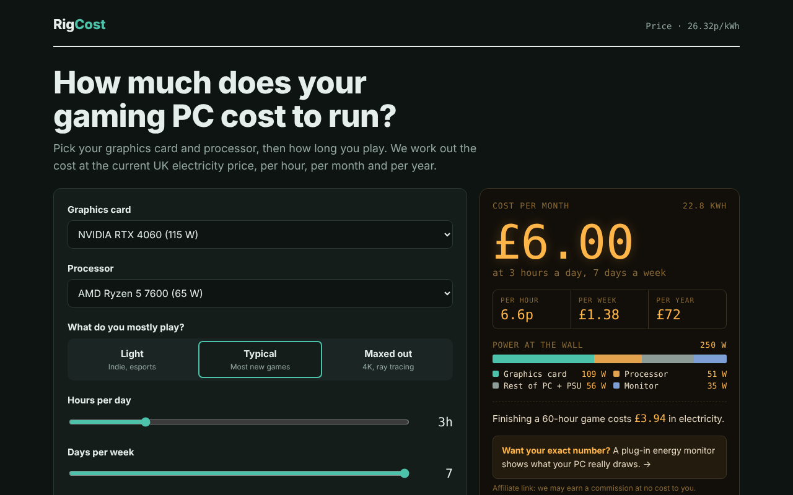
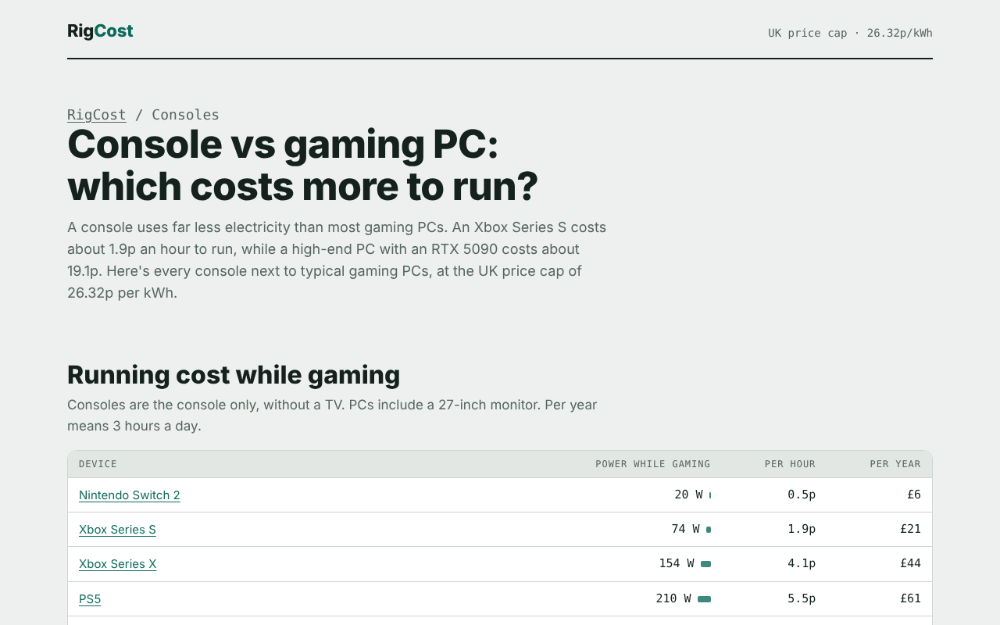

# RigCost

**Live site: [rigcost.co.uk](https://rigcost.co.uk)**

A free calculator that shows UK gamers what their gaming PC costs to run. Pick a graphics card, processor, monitor and how long you play, and it works out the electricity cost per hour, week, month and year at the current UK price cap.



## What it does

- **Live calculator** for 30 graphics cards and 15 processors, with three load levels (light, typical, maxed out), playing hours and your own electricity rate.
- **Power breakdown** showing how much goes to the graphics card, processor, the rest of the PC and the monitor.
- **53 pages built for search:** one page per graphics card and per processor, five console pages (PS5, PS5 Pro, Xbox Series X and S, Switch 2), a console vs PC comparison and a money-saving guide.
- **Sourced data:** the Ofgem price cap for October–December 2026 (26.32p/kWh), manufacturers' rated power figures, and Microsoft's, Sony's and independent measurements for consoles. Sources are listed on each page.



## How it's built

- **No framework.** One self-contained HTML file (`rigcost.html`) holds the calculator's markup, styles and JavaScript.
- **Static site generator.** `build.py` (Python, standard library only) turns it into 53 pages: it pre-selects the right part on each page, writes crawlable cost tables, internal links, structured data (JSON-LD), a sitemap and robots.txt.
- **Hosting:** Cloudflare Workers static assets, on a custom domain. `wrangler.jsonc` points Cloudflare at the built `site/` folder.
- **Continuous deployment:** every push to `main` deploys automatically through Cloudflare Workers Builds.
- **Accessible and responsive:** labelled form controls, keyboard focus states, light and dark themes, reduced-motion support, and layouts tested down to phone width.
- **SEO:** canonical URLs, Open Graph share image, breadcrumb and FAQ structured data, verified in Google Search Console.

## How the cost is calculated

```
wall watts = (GPU rated W × load + CPU rated W × load + 50 W) ÷ 0.90 + monitor W
cost       = wall watts ÷ 1000 × hours × price per kWh
```

Load levels: light (GPU 60%, CPU 50%), typical (85%, 70%), maxed out (100%, 100%). The 0.90 accounts for an 80 Plus Gold power supply. The calculator's rate is editable, since tariffs differ.

## Running it locally

```bash
python3 build.py              # builds the site into ./site
cd site && python3 -m http.server 8000
```

Then open http://localhost:8000.

## Updating prices

When Ofgem announces a new price cap, change `RATE` in `build.py` and the default rate in `rigcost.html`, then rebuild.

---

Built by Edward Robotham with AI coding tools: product idea, data research, design and deployment.
